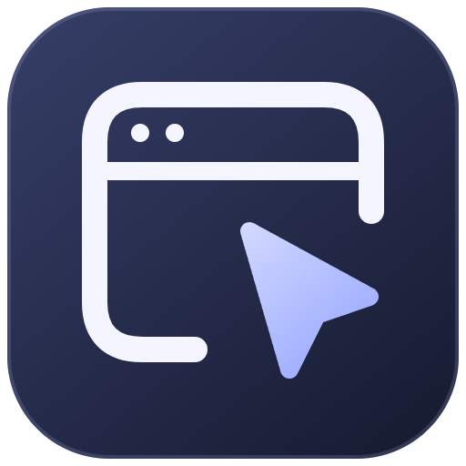
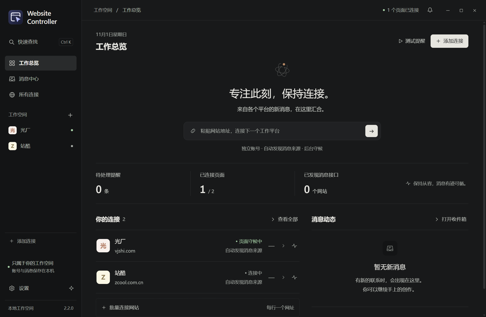
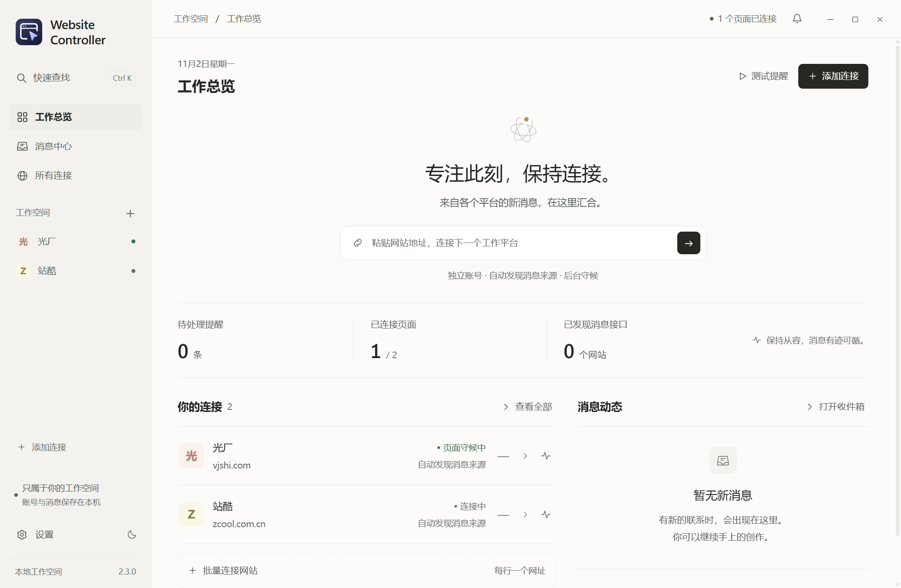

# Website Controller

把多个网站放进一个桌面工作台，集中查看消息和连接状态，适合需要同时留意多个工作平台的人。

每个网站使用独立的登录会话。登录后打开消息页，软件会尝试寻找未读接口和推送来源，也可以直接监听页面上的角标和消息内容。

[下载安装包](https://github.com/AndyMaa/Website-Controller/releases/latest) · [更新记录](CHANGELOG.md) · [反馈问题](https://github.com/AndyMaa/Website-Controller/issues)

## 下载

| 系统 | 选择 |
| --- | --- |
| Windows 10 / 11，64 位 | [安装版](https://github.com/AndyMaa/Website-Controller/releases/download/v2.2.1/Website-Controller-2.2.1-x64-Setup.exe) |
| Windows，想直接运行 | [免安装版](https://github.com/AndyMaa/Website-Controller/releases/download/v2.2.1/Website-Controller-2.2.1-x64-Portable.exe) |
| macOS 13 及以上，Apple 芯片 | [ARM64 DMG](https://github.com/AndyMaa/Website-Controller/releases/download/v2.2.1/Website-Controller-2.2.1-macOS-arm64.dmg) |
| macOS 13 及以上，Intel 芯片 | [x64 DMG](https://github.com/AndyMaa/Website-Controller/releases/download/v2.2.1/Website-Controller-2.2.1-macOS-x64.dmg) |

Mac 用户可在“关于本机”中查看芯片类型。打开 DMG 后，将应用拖到“应用程序”；Release 中也提供 ZIP 包和 SHA-256 校验文件。

Windows 包未做商业签名；macOS 包使用临时签名，未做 Apple 公证，首次打开可能受到系统限制。

## 开始使用

1. 添加网站，在软件内登录，进入网站的消息或私信页。
2. 点击“设为起始页”，下次直接回到这里。
3. 打开“连接详情”，查看是否发现消息来源。没有找到时，可在“监测规则”中点选未读角标和最新消息区域。
4. 用一条真实来信确认提醒效果，并在设置中测试桌面通知。

关闭窗口默认收起到托盘或菜单栏，监测继续运行。要完全退出，请使用托盘菜单；Mac 也可以按 ⌘Q。快捷查找支持 Windows 的 Ctrl+K 和 Mac 的 ⌘K。

## 能做什么

- 同时打开多个真实网站，各自保留登录状态。
- 识别常见 JSON 未读计数，监听 WebSocket、SSE 和部分 Socket.IO 文本消息。
- 对已经确认、符合条件的同源未读 GET 接口，目标约每 3 秒检查一次。
- 将识别到的变化放进消息中心，提供桌面通知、提醒声音和免打扰。
- 批量添加网址、自动去重，最多保存 500 个网站配置。
- 深浅主题、快捷搜索、轻量动画，以及“减少动画”选项。

500 是配置数量，同时开多少个网站取决于电脑内存和网站本身的开销。软件不能让原网站更早发出消息；睡眠、断网、退出或登录失效时，也无法保证提醒。

“页面已连接”表示页面正常运行，不代表账号内所有消息都已接通。自动发现依赖实际流量，建议登录后进入消息页。二进制推送、特殊认证或不认识的数据结构，可以用页面规则补充。具体识别方式见 [消息监听说明](docs/monitoring.md)。

浅色界面

## 数据放在哪里

没有另外的云端消息服务器。网站浏览和计数检查直接连接原网站，配置与消息摘要保存在本机：

- Windows 沿用旧版目录：%APPDATA%\接单台
- macOS：~/Library/Application Support/Website Controller

实际路径可在设置中查看。各站点使用隔离的 Chromium 会话。导出的网站设置不包含 Cookie、登录凭据或消息记录；本地消息摘要没有额外加密，请妥善保管系统账号。

Windows 下的已有网站、登录会话和消息记录会继续使用。“设为已处理”仅更新软件中的提醒，不会替你在网站上标记已读。

## 从源码运行

需要 Node.js 24 和 Git。

~~~sh
git clone https://github.com/AndyMaa/Website-Controller.git
cd Website-Controller
npm ci
npm start
~~~

检查和打包：

~~~sh
npm test
npm run test:e2e
npm run test:network
npm run build       # 在 Windows 上构建 EXE
npm run build:mac   # 在 macOS 上构建 DMG / ZIP
~~~

桌面测试使用独立的本地配置与 HTTP、WebSocket、SSE 测试页，不读取日常登录会话。报告和截图写入 test-results/。

界面在 src/ui/，页面监听在 src/guest-preload.cjs，网络识别在 src/network-monitor.cjs，窗口与通知逻辑在 src/main.cjs。发布流程见 [开发与发布说明](docs/releasing.md)。

## 反馈与贡献

遇到问题时，请附上系统、软件版本、网站名称和复现步骤。截图前遮住客户姓名、消息正文和账号信息，切勿上传 Cookie 或整个会话目录。

欢迎提交具体的修复或改进，详见 [CONTRIBUTING.md](CONTRIBUTING.md)。本项目采用 [MIT 许可证](LICENSE)。
